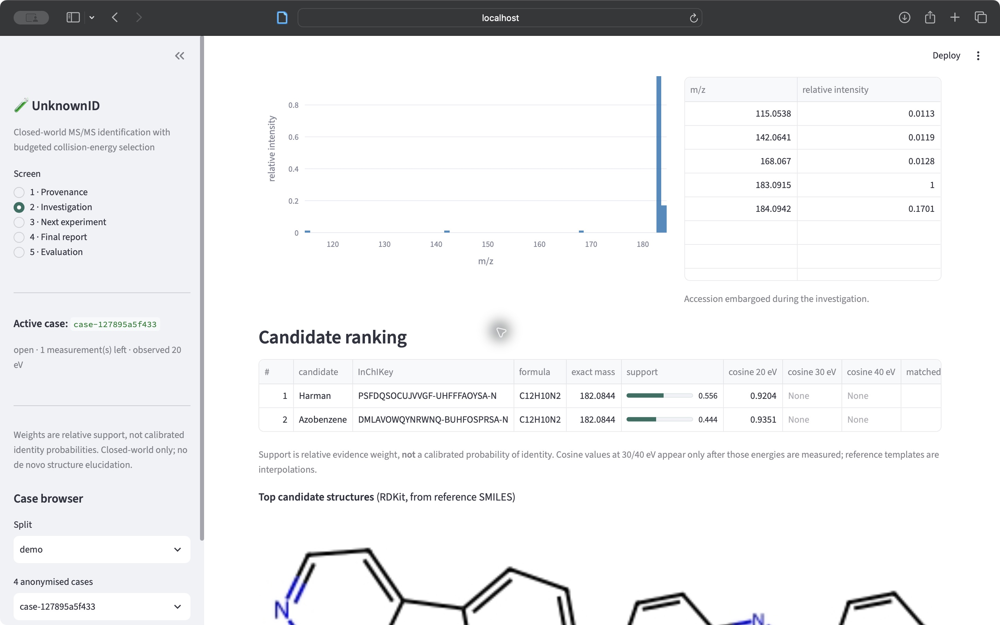
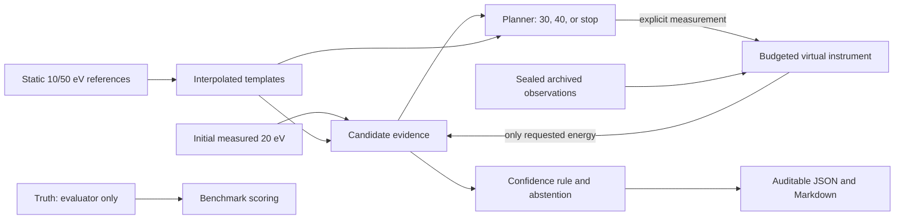

# UnknownID

**Problem:** unnecessary MS/MS acquisitions consume instrument time, while ambiguous spectra can invite overconfident identifications.

**Solution:** UnknownID ranks known library candidates, then chooses one archived 30/40 eV measurement or stops, with an auditable abstention decision.

**Observe → choose/stop → report.** Start with measured 20 eV evidence, inspect the next experiment, and export the evidence trail.

**Frozen result:** on 11 precursor-ambiguous test molecules, UnknownID and always-40 each accepted 9 correct identities with no observed accepted errors. UnknownID used **7 optional scans versus 11** (36% fewer; paired 95% CI for savings: 0.091–0.636 scans/case). No supported accuracy improvement or equivalence claim.

> **Scope: closed-world spectral-library identification, not de novo structure elucidation.** The true compound is in the reference library by construction.



**Local demo:** [localhost:8501](http://localhost:8501) after `make demo`. No hosted deployment is configured.

## 60-second quick start

Requires git, [uv](https://docs.astral.sh/uv/) and make. Dependency download time depends on your connection.

```bash
git clone https://github.com/Vivian0108/AI_MS_molecule_identification_draft.git
cd AI_MS_molecule_identification_draft
git checkout hackathon-ready
make setup                    # Python 3.12, exact uv.lock, development tools
make demo                     # http://localhost:8501
```

The committed demo needs no `make fetch-data` or `make prepare`. It contains four
curated train/dev examples with original attribution. The API and UI default to demo
mode when the research oracle is absent. Force demo with `UNKNOWNID_MODE=demo`.

1. **Observe:** on Investigation, start `case-127895a5f433` and inspect competing candidates and the initial 20 eV spectrum.
2. **Choose/stop:** open Next experiment, inspect the rationale, and measure the recommended 40 eV archived spectrum.
3. **Report:** stop the investigation, inspect the verdict, then export JSON and Markdown.

Try `case-250b6ac895d0` for a correct stop, or `case-e40ea5350560` for responsible abstention.
These are curated demonstrations, including training examples, **not independent evidence**.

## Why it matters

Each additional MS/MS acquisition occupies the instrument. A workflow that reaches
useful identification coverage with fewer optional scans could free acquisition capacity.
Here, saved scans are measured in a virtual instrument using archived experimental
spectra; no wall-clock instrument throughput improvement has been established.
Unresolved cases should remain explicitly ambiguous rather than become unsupported identities.

## What is novel

The project combines budget-aware experiment selection with uncertainty-aware stopping,
a sealed experimental oracle of archived measurements, and an auditable report with
abstention. The contribution is the workflow and its evaluation.

Spectral-library matching, spectral interpolation, MassBank data and cosine-based evidence
are prior work. We acknowledge the [2022 spectral-interpolation study](https://doi.org/10.1021/acs.jcim.2c00620).
Numerical scoring is deterministic. No LLM participates in the identification loop.

## Scientific result and limits

The primary benchmark stays the original frozen test split: 100 molecules, of which
**11 have at least two precursor-consistent candidates at 10 ppm**. The remaining 89
are precursor-unique. The initial cohort definition never uses hidden energy outcomes.
The primary product budget is one optional acquisition.

| Stage one, ambiguous n=11 | Accepted correct | Coverage | Observed risk | Optional scans/case | Total acquisitions/case |
|---|---:|---:|---:|---:|---:|
| Single initial scan | 7 | 0.6364 | 0 | 0 | 1 |
| Always 30 eV | 8 | 0.7273 | 0 | 1 | 2 |
| Always 40 eV | 9 | 0.8182 | 0 | 1 | 2 |
| Random (20 seeded trials) | 8.4 expected | 0.7636 | 0 | 1 | 2 |
| Cheap disagreement | 9 | 0.8182 | 0 | 1 | 2 |
| UnknownID | 9 | 0.8182 | 0 | 0.6364 | 1.6364 |
| Oracle diagnostic | 9 | 0.8182 | 0 | 1 | 2 |

Top-1 is 9/11 for all spectral policies. Acceptance and top-1 accuracy are different:
coverage counts only identities that pass the frozen confidence rule. “Scans” always
means optional scans; total acquisitions include the initial measured 20 eV scan.
All generated numerical tables and paired molecule-bootstrap intervals are in
[the scientific report](reports/evaluation.md) and its [JSON source](reports/evaluation.json).


The corrected report compares the same stage throughout. Benefits use UnknownID minus
baseline; scan savings use baseline minus UnknownID. Stage two is secondary. The
oracle tries independent one-measurement branches and uses truth only in evaluation.
Observed equality does not prove equivalence, and zero observed selective errors does
not prove zero population risk.

Energy-choice and stop diagnostics use a predeclared epsilon of 0.02 nats. They show
outcome-conditioned energy-sensitive subsets separately and expose missed-benefit
stops. They never redefine the primary cohort. See the report for definitions and denominators.

**Limits:** a small, homogeneous Bruker maXis Impact cohort; correlated acquisitions;
uncalibrated relative support; no enantiomer discrimination or cross-instrument claim.
Removing the true identity produces confident wrong matches in 6/11 cases with
alternatives: **open-world rejection remains unsolved**. No de novo, clinical,
regulatory or real-instrument-control claims are supported. No secondary cross-validation
estimate is included.

## Architecture and leakage boundary



The planner receives templates, weights, precursor metadata and budget, with no oracle
handle or truth argument. ReferenceStore rejects non-endpoint energies. The service
strips measured accessions until stop and never returns truth. Tests enforce budget,
energy restrictions, hidden-data isolation and pre-stop report rejection.

Demo sealed files are server-side application resources, not encrypted secrets against
someone inspecting the repository. Only curated train/dev observations are bundled.
The full research oracle and acquisition logs remain gitignored under `data/oracle/`.
The committed research spectra are evaluator inputs, never demo reference inputs.

## Five screens

| Screen | Purpose | Screenshot |
|---|---|---|
| Provenance | Source snapshot, cohort and license information | [View](docs/screenshots/01-provenance.png) |
| Investigation | Initial evidence, candidate structures and mirror spectrum | [View](docs/screenshots/02-investigation.png) |
| Next experiment | Predicted value, explicit measure/stop and budget | [View](docs/screenshots/03-next-experiment.png) |
| Final report | Before/after evidence, limitations and exports | [View](docs/screenshots/04-final-report.png) |
| Evaluation | Stage-aligned metrics, Pareto plot and paired differences | [View](docs/screenshots/05-evaluation.png) |

## Reproducibility and provenance

[Exact reproduction commands](REPRODUCIBILITY.md) cover the clean-clone demo,
locked environments, frozen-oracle restoration, report generation and the full
research pipeline. Run `make verify` for tests, imports, configs, formatting and linting.
Run `.venv/bin/python scripts/rehearse_demo.py` to exercise actual HTTP servers.
CI runs these checks on Python 3.11 and 3.12.

MassBank snapshot: `befc8a1e2f2aef899747797c081a5d80fab12fe7`, contributor Athens_Univ.
Selection retains the historical same-instrument, positive ESI, CID, `[M+H]+`, fixed
10/20/30/40/50 eV and 10 ppm filters. There are 503 complete cases and a 561-molecule
endpoint library. The historical [data audit](reports/data_audit.md) and
[calibration report](reports/calibration.md) remain unchanged. Split and Monte Carlo
seeds remain `20261020`; fitted model and calibration hashes are checked by tests.

Dependencies resolve in `uv.lock`, generated with Python 3.12. Core tools are RDKit,
NumPy/SciPy, pandas/PyArrow, FastAPI, Streamlit and Plotly. The custom greedy cosine
routine provides numerical matching; matchms is an acknowledged dependency/prior tool.
Generation metadata records the source Git commit, config/model/split hashes, dataset
version, Python version, lock hash and UTC timestamp. Runtime and timestamps may vary.

Code: [MIT](LICENSE). Data: [per-record CC BY / CC BY-SA obligations](DATA_LICENSE.md),
with [demo attribution](data/demo/attribution.json) and original source records.
[Citation](CITATION.cff). [Sanitized historical transcript](chat_history/transcript.md).
Historical `main` and its reports remain available at commit `e5b6ad8`.

## Judge demonstration

[Three-minute presentation and exact demo script](docs/JUDGE_DEMO.md),
[judge questions and answers](docs/JUDGE_QA.md), and
[readiness checklist with verification results](HACKATHON_READINESS.md).

## Troubleshooting

- **Python/dependency error:** install uv, then `make setup`; use the generated `.venv`.
- **No research oracle:** `make demo` always uses the committed curated bundle. For research, use `make restore-oracle` to reconstruct the exact frozen oracle and verify its historical hash.
- **Port occupied:** `make demo UI_PORT=8502`. API: `make api` on port 8000.
- **No active case:** start an investigation on screen 2 before planning or reporting.
- **Budget exhausted/duplicate energy:** one optional measurement is allowed; stop to export, or discard and restart the case.
- **Research mode requested accidentally:** set `UNKNOWNID_MODE=demo`. Research mode is explicit with `UNKNOWNID_MODE=research`.
