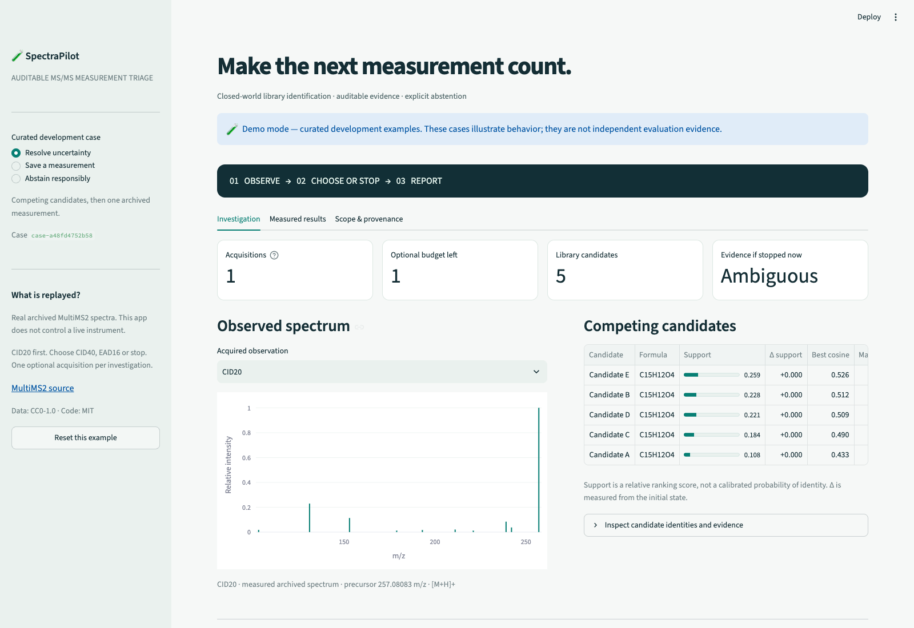
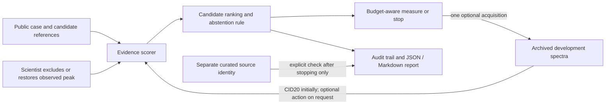

# SpectraPilot

**Problem:** Unnecessary MS/MS acquisitions consume instrument time, while unresolved candidate matches can be overclaimed.

**Solution:** SpectraPilot shows the evidence, recommends another archived measurement or a stop, and exports an auditable identification or abstention.



**Observe → choose or stop → report.** Inspect the initial CID20 spectrum and competing library candidates; reveal one recommended archived spectrum; export JSON and Markdown. You can exclude an observed peak with a reason and undo the intervention.

**Measured result:** In an exploratory scaffold-grouped training cross-validation study of 277 ambiguous molecules, the library-assisted planner used **243 optional acquisitions versus 277** for always-CID40 (12.3% fewer), with **156 versus 157 accepted-correct identifications and 15 accepted errors for each**. This is a tradeoff, not evidence of equivalent accuracy. [Generated scientific report](reports/spectrapilot/train_stage1_reference.md).

> **Scope: closed-world library identification, not de novo structure elucidation.** Demo mode uses three outcome-selected development examples and archived MultiMS2 spectra. They are illustrations, not independent evaluation evidence. There is no hosted deployment at present.

## Run the demo

Python **3.12**, Git and Make are required. From the repository root:

```bash
python3.12 -m venv .venv
.venv/bin/python -m pip install --require-hashes -r requirements-demo.lock
make demo
```

Open **http://127.0.0.1:8502**. No full dataset, private oracle, `make fetch-data`, or `make prepare` is needed. The small licensed bundle is committed under [`data/demo/`](data/demo/README.md). Installation time depends on the network; subsequent startup is one command.

- **Resolve uncertainty:** the leading candidate changes after CID40 and the rule accepts an identification.
- **Save a measurement:** the planner recommends stopping after CID20.
- **Abstain responsibly:** one additional spectrum still leaves ambiguity.

Run `make demo-verify` for the 11 automated demo checks. `make demo-api` starts the optional API on port 8001; `/health` reports demo mode. The UI uses the service directly and does not need that API process.

## Why it matters

Every optional acquisition uses instrument time. A useful assistant must expose the evidence behind its recommendation and say when the available evidence does not resolve the candidates. SpectraPilot makes the choice and its consequences visible, including a scientist's reversible peak exclusions.

## What is new in this prototype

The contribution is the combination of budget-aware experiment selection, uncertainty-aware stopping, archived measurements revealed on request, reversible scientist interventions, and an auditable evidence report with explicit abstention. Spectral-library matching, cosine evidence, spectral interpolation and the source MassBank/MultiMS2 data are prior work. The demo is not a validated new fragmentation predictor or an autonomous laboratory agent.



The oracle boundary is enforced by application interfaces, not encryption: anyone with filesystem access can inspect the redistributable development files. Neither hidden measured spectra nor evaluator truth are returned in initial evidence or planning payloads. A selected case's title intentionally indicates the kind of demonstration.

## Evidence and limitations

The [training reference study](reports/spectrapilot/train_reference_quality.md) and [stage-one study](reports/spectrapilot/train_stage1_reference.md) motivated this demonstration. In the separate predicted-reference track, donor agreement increased accepted-correct identifications from 20 to 49 of 277, with three accepted errors in each; this is an exploratory training comparison, not independent validation. The demo additionally permits development CID60 library anchors. CID60 is an imperfect reference for CID40 and the mismatch is disclosed.

No benefit from adaptive CID versus EAD selection has been established: the studied planner chose CID40 or stop. Relative support is not a calibrated identity probability. Performance is not established for unknown structures, other instruments, or live acquisition. Thresholds, splits, seeds and existing scientific reports are unchanged by the demo work. The older frozen MassBank result remains a separate benchmark; it must not be pooled with MultiMS2 or the curated examples.

## Judge materials and screenshots

- [Three-minute script and questions](docs/JUDGE_DEMO.md)
- [Reproducibility and provenance](docs/DEMO_REPRODUCIBILITY.md)
- [Readiness checklist](HACKATHON_READINESS.md)
- Screens: [start](docs/screenshots/01-start.png), [observe](docs/screenshots/02-observe.png), [measure](docs/screenshots/03-measure.png), [export](docs/screenshots/04-report.png), [stop](docs/screenshots/05-stop.png), [abstain](docs/screenshots/06-abstain.png), [results](docs/screenshots/07-results.png)

## Research workflow

Research scripts remain in `scripts/`, scientific code in `src/spectrapilot/`, the demo screen in `app/spectrapilot_demo.py`, and committed demo data in `data/demo/`. The older UnknownID implementation is in `src/unknownid/`. [Historical UnknownID instructions](docs/UNKNOWNID_RESEARCH.md) describe its separate MassBank workflow; [the implementation specification](UnknownID_Hackathon_Implementation_Spec.md) records that original design.

For the full scientific dependency environment, use `requirements-research.lock`, then `make verify`. Research report regeneration requires the separately prepared source dataset and private oracle. See the exact commands and limits in [reproducibility](docs/DEMO_REPRODUCIBILITY.md). Do not regenerate datasets or tune parameters simply to launch the demo.

## Troubleshooting

- Port busy: `make demo DEMO_PORT=8503`, or `make demo-api DEMO_API_PORT=8002`.
- Missing module: use the Python 3.12 environment above and run commands at the repository root. Make exports `PYTHONPATH=src`.
- Bundle checksum error: restore committed `data/demo/` and the frozen configs. Do not manually patch numerical results.
- An investigation uses one optional acquisition. Reset the example to start again. Stop before exporting a report or requesting its curated identity check.

Code is [MIT](LICENSE). The bundled MultiMS2 data is CC0-1.0 with accession-level attribution; historical MassBank licensing is separate. See [DATA_LICENSE.md](DATA_LICENSE.md). A [sanitized historical build transcript](chat_history/transcript.md) is retained for provenance.
