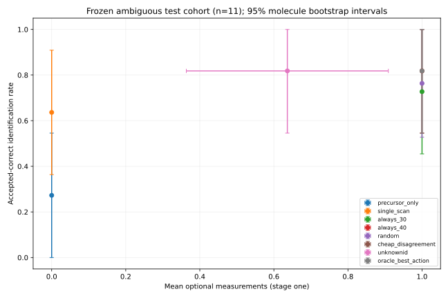

# UnknownID evaluation

*Generated 2026-10-21T18:07:12+00:00.  Frozen split and policies; no test-set tuning.*

## Claim tested

UnknownID uses uncertainty-aware stopping and experiment selection to achieve a target identification coverage with fewer optional measurements than an always-measure policy. This is a hypothesis; the stage-one results below determine what is supported.

## Frozen design

- Test molecules only; no train/dev molecule appears in the test split.
- Initial query: measured 20 eV spectrum. Reference library: 10/50 eV only. Hidden measurements: 30/40 eV.
- Candidate universe: all precursor-consistent library molecules at 10 ppm, same `[M+H]+` adduct.
- Acquisition method selected on dev: `monte_carlo_ig`.
- Default measurement budget in the API: 1; the evaluation curve uses up to 2 acquisitions.
- Random policy averages 20 seeded trials per molecule.
- Confidence intervals resample molecules, not spectra or energies.

## Cohorts

| Cohort | Cases |
|---|---:|
| all test | 100 |
| ambiguous (>=2 precursor-consistent candidates) | 11 |
| close-call (top-2 margin <= 0.15) | 4 |
| easy (precursor-unique) | 89 |

## Headline result

Ambiguous frozen test cohort: n=11. Stage one: UnknownID accepted-correct 9.0, coverage=0.8182, selective risk=0.0; always-40 accepted-correct 9.0, coverage=0.8182, risk=0.0. Optional scans per case: 0.6364 versus 1.0; total acquisitions: 1.6364 versus 2.0. Top-1@1=0.8182 versus 0.8182. No paired interval supports an accuracy improvement over fixed/random choice. Observed equal performance does not establish equivalence or noninferiority. Small-cohort proof of concept only.

Scans always means optional scans. Total acquisitions = 1 + optional scans.
Stage 0 is the initial 20 eV observation; stages 1 and 2 cap optional acquisitions.
Stopped policies carry their last state forward. Stage one is the primary product budget.


## Results — ambiguous, stage 0 (secondary)

| Policy | n | Top-1 | MRR | Top-3 | Accepted correct | Coverage | Risk | Optional scans | Total acquisitions | Scans / accepted correct |
|---|---:|---:|---:|---:|---:|---:|---:|---:|---:|---:|
| precursor_only | 11 | 0.364 | 0.636 | 1.000 | 3.000 | 0.273 | 0.000 | 0.000 | 1.000 | 0.000 |
| single_scan | 11 | 0.818 | 0.894 | 1.000 | 7.000 | 0.636 | 0.000 | 0.000 | 1.000 | 0.000 |
| always_30 | 11 | 0.818 | 0.894 | 1.000 | 7.000 | 0.636 | 0.000 | 0.000 | 1.000 | 0.000 |
| always_40 | 11 | 0.818 | 0.894 | 1.000 | 7.000 | 0.636 | 0.000 | 0.000 | 1.000 | 0.000 |
| random | 11 | 0.818 | 0.894 | 1.000 | 7.000 | 0.636 | 0.000 | 0.000 | 1.000 | 0.000 |
| cheap_disagreement | 11 | 0.818 | 0.894 | 1.000 | 7.000 | 0.636 | 0.000 | 0.000 | 1.000 | 0.000 |
| unknownid | 11 | 0.818 | 0.894 | 1.000 | 7.000 | 0.636 | 0.000 | 0.000 | 1.000 | 0.000 |
| oracle_best_action | 11 | 0.818 | 0.894 | 1.000 | 7.000 | 0.636 | 0.000 | 0.000 | 1.000 | 0.000 |

## Results — ambiguous, stage 1 (primary)

| Policy | n | Top-1 | MRR | Top-3 | Accepted correct | Coverage | Risk | Optional scans | Total acquisitions | Scans / accepted correct |
|---|---:|---:|---:|---:|---:|---:|---:|---:|---:|---:|
| precursor_only | 11 | 0.364 | 0.636 | 1.000 | 3.000 | 0.273 | 0.000 | 0.000 | 1.000 | 0.000 |
| single_scan | 11 | 0.818 | 0.894 | 1.000 | 7.000 | 0.636 | 0.000 | 0.000 | 1.000 | 0.000 |
| always_30 | 11 | 0.818 | 0.894 | 1.000 | 8.000 | 0.727 | 0.000 | 1.000 | 2.000 | 1.375 |
| always_40 | 11 | 0.818 | 0.909 | 1.000 | 9.000 | 0.818 | 0.000 | 1.000 | 2.000 | 1.222 |
| random | 11 | 0.818 | 0.902 | 1.000 | 8.400 | 0.764 | 0.000 | 1.000 | 2.000 | 1.310 |
| cheap_disagreement | 11 | 0.818 | 0.909 | 1.000 | 9.000 | 0.818 | 0.000 | 1.000 | 2.000 | 1.222 |
| unknownid | 11 | 0.818 | 0.909 | 1.000 | 9.000 | 0.818 | 0.000 | 0.636 | 1.636 | 0.778 |
| oracle_best_action | 11 | 0.818 | 0.909 | 1.000 | 9.000 | 0.818 | 0.000 | 1.000 | 2.000 | 1.222 |

## Results — ambiguous, stage 2 (secondary)

| Policy | n | Top-1 | MRR | Top-3 | Accepted correct | Coverage | Risk | Optional scans | Total acquisitions | Scans / accepted correct |
|---|---:|---:|---:|---:|---:|---:|---:|---:|---:|---:|
| precursor_only | 11 | 0.364 | 0.636 | 1.000 | 3.000 | 0.273 | 0.000 | 0.000 | 1.000 | 0.000 |
| single_scan | 11 | 0.818 | 0.894 | 1.000 | 7.000 | 0.636 | 0.000 | 0.000 | 1.000 | 0.000 |
| always_30 | 11 | 0.818 | 0.909 | 1.000 | 9.000 | 0.818 | 0.000 | 2.000 | 3.000 | 2.444 |
| always_40 | 11 | 0.818 | 0.909 | 1.000 | 9.000 | 0.818 | 0.000 | 2.000 | 3.000 | 2.444 |
| random | 11 | 0.818 | 0.909 | 1.000 | 9.000 | 0.818 | 0.000 | 2.000 | 3.000 | 2.444 |
| cheap_disagreement | 11 | 0.818 | 0.909 | 1.000 | 9.000 | 0.818 | 0.000 | 2.000 | 3.000 | 2.444 |
| unknownid | 11 | 0.818 | 0.909 | 1.000 | 9.000 | 0.818 | 0.000 | 0.727 | 1.727 | 0.889 |
| oracle_best_action | 11 | 0.818 | 0.909 | 1.000 | 9.000 | 0.818 | 0.000 | 1.000 | 2.000 | 1.222 |

## Results — all, stage 0 (secondary)

| Policy | n | Top-1 | MRR | Top-3 | Accepted correct | Coverage | Risk | Optional scans | Total acquisitions | Scans / accepted correct |
|---|---:|---:|---:|---:|---:|---:|---:|---:|---:|---:|
| precursor_only | 100 | 0.930 | 0.960 | 1.000 | 89.000 | 0.890 | 0.000 | 0.000 | 1.000 | 0.000 |
| single_scan | 100 | 0.980 | 0.988 | 1.000 | 93.000 | 0.930 | 0.000 | 0.000 | 1.000 | 0.000 |
| always_30 | 100 | 0.980 | 0.988 | 1.000 | 93.000 | 0.930 | 0.000 | 0.000 | 1.000 | 0.000 |
| always_40 | 100 | 0.980 | 0.988 | 1.000 | 93.000 | 0.930 | 0.000 | 0.000 | 1.000 | 0.000 |
| random | 100 | 0.980 | 0.988 | 1.000 | 93.000 | 0.930 | 0.000 | 0.000 | 1.000 | 0.000 |
| cheap_disagreement | 100 | 0.980 | 0.988 | 1.000 | 93.000 | 0.930 | 0.000 | 0.000 | 1.000 | 0.000 |
| unknownid | 100 | 0.980 | 0.988 | 1.000 | 93.000 | 0.930 | 0.000 | 0.000 | 1.000 | 0.000 |
| oracle_best_action | 100 | 0.980 | 0.988 | 1.000 | 93.000 | 0.930 | 0.000 | 0.000 | 1.000 | 0.000 |

## Results — all, stage 1 (primary)

| Policy | n | Top-1 | MRR | Top-3 | Accepted correct | Coverage | Risk | Optional scans | Total acquisitions | Scans / accepted correct |
|---|---:|---:|---:|---:|---:|---:|---:|---:|---:|---:|
| precursor_only | 100 | 0.930 | 0.960 | 1.000 | 89.000 | 0.890 | 0.000 | 0.000 | 1.000 | 0.000 |
| single_scan | 100 | 0.980 | 0.988 | 1.000 | 93.000 | 0.930 | 0.000 | 0.000 | 1.000 | 0.000 |
| always_30 | 100 | 0.980 | 0.988 | 1.000 | 95.000 | 0.950 | 0.000 | 1.000 | 2.000 | 1.053 |
| always_40 | 100 | 0.980 | 0.990 | 1.000 | 98.000 | 0.980 | 0.000 | 1.000 | 2.000 | 1.020 |
| random | 100 | 0.980 | 0.989 | 1.000 | 96.650 | 0.967 | 0.000 | 1.000 | 2.000 | 1.035 |
| cheap_disagreement | 100 | 0.980 | 0.990 | 1.000 | 95.000 | 0.950 | 0.000 | 0.110 | 1.110 | 0.116 |
| unknownid | 100 | 0.980 | 0.990 | 1.000 | 95.000 | 0.950 | 0.000 | 0.070 | 1.070 | 0.074 |
| oracle_best_action | 100 | 0.980 | 0.990 | 1.000 | 96.000 | 0.960 | 0.000 | 1.000 | 2.000 | 1.042 |

## Results — all, stage 2 (secondary)

| Policy | n | Top-1 | MRR | Top-3 | Accepted correct | Coverage | Risk | Optional scans | Total acquisitions | Scans / accepted correct |
|---|---:|---:|---:|---:|---:|---:|---:|---:|---:|---:|
| precursor_only | 100 | 0.930 | 0.960 | 1.000 | 89.000 | 0.890 | 0.000 | 0.000 | 1.000 | 0.000 |
| single_scan | 100 | 0.980 | 0.988 | 1.000 | 93.000 | 0.930 | 0.000 | 0.000 | 1.000 | 0.000 |
| always_30 | 100 | 0.980 | 0.990 | 1.000 | 98.000 | 0.980 | 0.000 | 2.000 | 3.000 | 2.041 |
| always_40 | 100 | 0.980 | 0.990 | 1.000 | 98.000 | 0.980 | 0.000 | 2.000 | 3.000 | 2.041 |
| random | 100 | 0.980 | 0.990 | 1.000 | 98.000 | 0.980 | 0.000 | 2.000 | 3.000 | 2.041 |
| cheap_disagreement | 100 | 0.980 | 0.990 | 1.000 | 95.000 | 0.950 | 0.000 | 0.220 | 1.220 | 0.232 |
| unknownid | 100 | 0.980 | 0.990 | 1.000 | 95.000 | 0.950 | 0.000 | 0.080 | 1.080 | 0.084 |
| oracle_best_action | 100 | 0.980 | 0.990 | 1.000 | 96.000 | 0.960 | 0.000 | 1.000 | 2.000 | 1.042 |

## Results — close_call, stage 0 (secondary)

| Policy | n | Top-1 | MRR | Top-3 | Accepted correct | Coverage | Risk | Optional scans | Total acquisitions | Scans / accepted correct |
|---|---:|---:|---:|---:|---:|---:|---:|---:|---:|---:|
| precursor_only | 4 | 0.250 | 0.583 | 1.000 | 1.000 | 0.250 | 0.000 | 0.000 | 1.000 | 0.000 |
| single_scan | 4 | 0.500 | 0.708 | 1.000 | 0.000 | 0.000 | — | 0.000 | 1.000 | — |
| always_30 | 4 | 0.500 | 0.708 | 1.000 | 0.000 | 0.000 | — | 0.000 | 1.000 | — |
| always_40 | 4 | 0.500 | 0.708 | 1.000 | 0.000 | 0.000 | — | 0.000 | 1.000 | — |
| random | 4 | 0.500 | 0.708 | 1.000 | 0.000 | 0.000 | — | 0.000 | 1.000 | — |
| cheap_disagreement | 4 | 0.500 | 0.708 | 1.000 | 0.000 | 0.000 | — | 0.000 | 1.000 | — |
| unknownid | 4 | 0.500 | 0.708 | 1.000 | 0.000 | 0.000 | — | 0.000 | 1.000 | — |
| oracle_best_action | 4 | 0.500 | 0.708 | 1.000 | 0.000 | 0.000 | — | 0.000 | 1.000 | — |

## Results — close_call, stage 1 (primary)

| Policy | n | Top-1 | MRR | Top-3 | Accepted correct | Coverage | Risk | Optional scans | Total acquisitions | Scans / accepted correct |
|---|---:|---:|---:|---:|---:|---:|---:|---:|---:|---:|
| precursor_only | 4 | 0.250 | 0.583 | 1.000 | 1.000 | 0.250 | 0.000 | 0.000 | 1.000 | 0.000 |
| single_scan | 4 | 0.500 | 0.708 | 1.000 | 0.000 | 0.000 | — | 0.000 | 1.000 | — |
| always_30 | 4 | 0.500 | 0.708 | 1.000 | 1.000 | 0.250 | 0.000 | 1.000 | 2.000 | 4.000 |
| always_40 | 4 | 0.500 | 0.750 | 1.000 | 2.000 | 0.500 | 0.000 | 1.000 | 2.000 | 2.000 |
| random | 4 | 0.500 | 0.731 | 1.000 | 1.400 | 0.350 | 0.000 | 1.000 | 2.000 | 2.857 |
| cheap_disagreement | 4 | 0.500 | 0.750 | 1.000 | 2.000 | 0.500 | 0.000 | 1.000 | 2.000 | 2.000 |
| unknownid | 4 | 0.500 | 0.750 | 1.000 | 2.000 | 0.500 | 0.000 | 1.000 | 2.000 | 2.000 |
| oracle_best_action | 4 | 0.500 | 0.750 | 1.000 | 2.000 | 0.500 | 0.000 | 1.000 | 2.000 | 2.000 |

## Results — close_call, stage 2 (secondary)

| Policy | n | Top-1 | MRR | Top-3 | Accepted correct | Coverage | Risk | Optional scans | Total acquisitions | Scans / accepted correct |
|---|---:|---:|---:|---:|---:|---:|---:|---:|---:|---:|
| precursor_only | 4 | 0.250 | 0.583 | 1.000 | 1.000 | 0.250 | 0.000 | 0.000 | 1.000 | 0.000 |
| single_scan | 4 | 0.500 | 0.708 | 1.000 | 0.000 | 0.000 | — | 0.000 | 1.000 | — |
| always_30 | 4 | 0.500 | 0.750 | 1.000 | 2.000 | 0.500 | 0.000 | 2.000 | 3.000 | 4.000 |
| always_40 | 4 | 0.500 | 0.750 | 1.000 | 2.000 | 0.500 | 0.000 | 2.000 | 3.000 | 4.000 |
| random | 4 | 0.500 | 0.750 | 1.000 | 2.000 | 0.500 | 0.000 | 2.000 | 3.000 | 4.000 |
| cheap_disagreement | 4 | 0.500 | 0.750 | 1.000 | 2.000 | 0.500 | 0.000 | 2.000 | 3.000 | 4.000 |
| unknownid | 4 | 0.500 | 0.750 | 1.000 | 2.000 | 0.500 | 0.000 | 1.250 | 2.250 | 2.500 |
| oracle_best_action | 4 | 0.500 | 0.750 | 1.000 | 2.000 | 0.500 | 0.000 | 1.000 | 2.000 | 2.000 |

## Results — easy, stage 0 (secondary)

| Policy | n | Top-1 | MRR | Top-3 | Accepted correct | Coverage | Risk | Optional scans | Total acquisitions | Scans / accepted correct |
|---|---:|---:|---:|---:|---:|---:|---:|---:|---:|---:|
| precursor_only | 89 | 1.000 | 1.000 | 1.000 | 86.000 | 0.966 | 0.000 | 0.000 | 1.000 | 0.000 |
| single_scan | 89 | 1.000 | 1.000 | 1.000 | 86.000 | 0.966 | 0.000 | 0.000 | 1.000 | 0.000 |
| always_30 | 89 | 1.000 | 1.000 | 1.000 | 86.000 | 0.966 | 0.000 | 0.000 | 1.000 | 0.000 |
| always_40 | 89 | 1.000 | 1.000 | 1.000 | 86.000 | 0.966 | 0.000 | 0.000 | 1.000 | 0.000 |
| random | 89 | 1.000 | 1.000 | 1.000 | 86.000 | 0.966 | 0.000 | 0.000 | 1.000 | 0.000 |
| cheap_disagreement | 89 | 1.000 | 1.000 | 1.000 | 86.000 | 0.966 | 0.000 | 0.000 | 1.000 | 0.000 |
| unknownid | 89 | 1.000 | 1.000 | 1.000 | 86.000 | 0.966 | 0.000 | 0.000 | 1.000 | 0.000 |
| oracle_best_action | 89 | 1.000 | 1.000 | 1.000 | 86.000 | 0.966 | 0.000 | 0.000 | 1.000 | 0.000 |

## Results — easy, stage 1 (primary)

| Policy | n | Top-1 | MRR | Top-3 | Accepted correct | Coverage | Risk | Optional scans | Total acquisitions | Scans / accepted correct |
|---|---:|---:|---:|---:|---:|---:|---:|---:|---:|---:|
| precursor_only | 89 | 1.000 | 1.000 | 1.000 | 86.000 | 0.966 | 0.000 | 0.000 | 1.000 | 0.000 |
| single_scan | 89 | 1.000 | 1.000 | 1.000 | 86.000 | 0.966 | 0.000 | 0.000 | 1.000 | 0.000 |
| always_30 | 89 | 1.000 | 1.000 | 1.000 | 87.000 | 0.978 | 0.000 | 1.000 | 2.000 | 1.023 |
| always_40 | 89 | 1.000 | 1.000 | 1.000 | 89.000 | 1.000 | 0.000 | 1.000 | 2.000 | 1.000 |
| random | 89 | 1.000 | 1.000 | 1.000 | 88.250 | 0.992 | 0.000 | 1.000 | 2.000 | 1.008 |
| cheap_disagreement | 89 | 1.000 | 1.000 | 1.000 | 86.000 | 0.966 | 0.000 | 0.000 | 1.000 | 0.000 |
| unknownid | 89 | 1.000 | 1.000 | 1.000 | 86.000 | 0.966 | 0.000 | 0.000 | 1.000 | 0.000 |
| oracle_best_action | 89 | 1.000 | 1.000 | 1.000 | 87.000 | 0.978 | 0.000 | 1.000 | 2.000 | 1.023 |

## Results — easy, stage 2 (secondary)

| Policy | n | Top-1 | MRR | Top-3 | Accepted correct | Coverage | Risk | Optional scans | Total acquisitions | Scans / accepted correct |
|---|---:|---:|---:|---:|---:|---:|---:|---:|---:|---:|
| precursor_only | 89 | 1.000 | 1.000 | 1.000 | 86.000 | 0.966 | 0.000 | 0.000 | 1.000 | 0.000 |
| single_scan | 89 | 1.000 | 1.000 | 1.000 | 86.000 | 0.966 | 0.000 | 0.000 | 1.000 | 0.000 |
| always_30 | 89 | 1.000 | 1.000 | 1.000 | 89.000 | 1.000 | 0.000 | 2.000 | 3.000 | 2.000 |
| always_40 | 89 | 1.000 | 1.000 | 1.000 | 89.000 | 1.000 | 0.000 | 2.000 | 3.000 | 2.000 |
| random | 89 | 1.000 | 1.000 | 1.000 | 89.000 | 1.000 | 0.000 | 2.000 | 3.000 | 2.000 |
| cheap_disagreement | 89 | 1.000 | 1.000 | 1.000 | 86.000 | 0.966 | 0.000 | 0.000 | 1.000 | 0.000 |
| unknownid | 89 | 1.000 | 1.000 | 1.000 | 86.000 | 0.966 | 0.000 | 0.000 | 1.000 | 0.000 |
| oracle_best_action | 89 | 1.000 | 1.000 | 1.000 | 87.000 | 0.978 | 0.000 | 1.000 | 2.000 | 1.023 |



Error bars are molecule-bootstrap 95% intervals. Oracle is a truth-aware diagnostic, not deployable.


## Paired differences versus the UnknownID policy

Benefits are UnknownID minus baseline; scans_1 is baseline minus UnknownID (scan savings). Positive values favour UnknownID. CIs are 95% molecule-level paired bootstrap intervals.  An interval spanning zero is reported as inconclusive, not as a win.

| Cohort | Baseline | Metric | Difference | 95% CI | UnknownID wins/losses | Differing molecules |
|---|---|---|---:|---|---|---:|
| all | precursor_only | top1_1 | +0.0500 | [+0.0100, +0.1000] | 5/0 | 5 |
| all | precursor_only | mrr_1 | +0.0300 | [+0.0067, +0.0583] | 5/0 | 5 |
| all | precursor_only | coverage_1 | +0.0600 | [+0.0200, +0.1100] | 6/0 | 6 |
| all | precursor_only | accepted_correct_1 | +0.0600 | [+0.0200, +0.1100] | 6/0 | 6 |
| all | precursor_only | scans_1 | -0.0700 | [-0.1200, -0.0300] | 0/7 | 7 |
| all | single_scan | top1_1 | +0.0000 | [+0.0000, +0.0000] | 0/0 | 0 |
| all | single_scan | mrr_1 | +0.0017 | [+0.0000, +0.0050] | 1/0 | 1 |
| all | single_scan | coverage_1 | +0.0200 | [+0.0000, +0.0500] | 2/0 | 2 |
| all | single_scan | accepted_correct_1 | +0.0200 | [+0.0000, +0.0500] | 2/0 | 2 |
| all | single_scan | scans_1 | -0.0700 | [-0.1200, -0.0300] | 0/7 | 7 |
| all | always_30 | top1_1 | +0.0000 | [+0.0000, +0.0000] | 0/0 | 0 |
| all | always_30 | mrr_1 | +0.0017 | [+0.0000, +0.0050] | 1/0 | 1 |
| all | always_30 | coverage_1 | +0.0000 | [-0.0300, +0.0300] | 1/1 | 2 |
| all | always_30 | accepted_correct_1 | +0.0000 | [-0.0300, +0.0300] | 1/1 | 2 |
| all | always_30 | scans_1 | +0.9300 | [+0.8800, +0.9700] | 93/0 | 93 |
| all | always_40 | top1_1 | +0.0000 | [+0.0000, +0.0000] | 0/0 | 0 |
| all | always_40 | mrr_1 | +0.0000 | [+0.0000, +0.0000] | 0/0 | 0 |
| all | always_40 | coverage_1 | -0.0300 | [-0.0700, +0.0000] | 0/3 | 3 |
| all | always_40 | accepted_correct_1 | -0.0300 | [-0.0700, +0.0000] | 0/3 | 3 |
| all | always_40 | scans_1 | +0.9300 | [+0.8800, +0.9700] | 93/0 | 93 |
| all | random | top1_1 | +0.0000 | [+0.0000, +0.0000] | 0/0 | 0 |
| all | random | mrr_1 | +0.0008 | [+0.0000, +0.0023] | 1/0 | 1 |
| all | random | coverage_1 | -0.0165 | [-0.0475, +0.0105] | 1/3 | 4 |
| all | random | accepted_correct_1 | -0.0165 | [-0.0475, +0.0105] | 1/3 | 4 |
| all | random | scans_1 | +0.9300 | [+0.8800, +0.9700] | 93/0 | 93 |
| all | cheap_disagreement | top1_1 | +0.0000 | [+0.0000, +0.0000] | 0/0 | 0 |
| all | cheap_disagreement | mrr_1 | +0.0000 | [+0.0000, +0.0000] | 0/0 | 0 |
| all | cheap_disagreement | coverage_1 | +0.0000 | [+0.0000, +0.0000] | 0/0 | 0 |
| all | cheap_disagreement | accepted_correct_1 | +0.0000 | [+0.0000, +0.0000] | 0/0 | 0 |
| all | cheap_disagreement | scans_1 | +0.0400 | [+0.0100, +0.0800] | 4/0 | 4 |
| all | oracle_best_action | top1_1 | +0.0000 | [+0.0000, +0.0000] | 0/0 | 0 |
| all | oracle_best_action | mrr_1 | +0.0000 | [+0.0000, +0.0000] | 0/0 | 0 |
| all | oracle_best_action | coverage_1 | -0.0100 | [-0.0300, +0.0000] | 0/1 | 1 |
| all | oracle_best_action | accepted_correct_1 | -0.0100 | [-0.0300, +0.0000] | 0/1 | 1 |
| all | oracle_best_action | scans_1 | +0.9300 | [+0.8800, +0.9700] | 93/0 | 93 |
| ambiguous | precursor_only | top1_1 | +0.4545 | [+0.1818, +0.7273] | 5/0 | 5 |
| ambiguous | precursor_only | mrr_1 | +0.2727 | [+0.0909, +0.4545] | 5/0 | 5 |
| ambiguous | precursor_only | coverage_1 | +0.5455 | [+0.2727, +0.8182] | 6/0 | 6 |
| ambiguous | precursor_only | accepted_correct_1 | +0.5455 | [+0.2727, +0.8182] | 6/0 | 6 |
| ambiguous | precursor_only | scans_1 | -0.6364 | [-0.9091, -0.3636] | 0/7 | 7 |
| ambiguous | single_scan | top1_1 | +0.0000 | [+0.0000, +0.0000] | 0/0 | 0 |
| ambiguous | single_scan | mrr_1 | +0.0152 | [+0.0000, +0.0455] | 1/0 | 1 |
| ambiguous | single_scan | coverage_1 | +0.1818 | [+0.0000, +0.4545] | 2/0 | 2 |
| ambiguous | single_scan | accepted_correct_1 | +0.1818 | [+0.0000, +0.4545] | 2/0 | 2 |
| ambiguous | single_scan | scans_1 | -0.6364 | [-0.9091, -0.3636] | 0/7 | 7 |
| ambiguous | always_30 | top1_1 | +0.0000 | [+0.0000, +0.0000] | 0/0 | 0 |
| ambiguous | always_30 | mrr_1 | +0.0152 | [+0.0000, +0.0455] | 1/0 | 1 |
| ambiguous | always_30 | coverage_1 | +0.0909 | [+0.0000, +0.2727] | 1/0 | 1 |
| ambiguous | always_30 | accepted_correct_1 | +0.0909 | [+0.0000, +0.2727] | 1/0 | 1 |
| ambiguous | always_30 | scans_1 | +0.3636 | [+0.0909, +0.6364] | 4/0 | 4 |
| ambiguous | always_40 | top1_1 | +0.0000 | [+0.0000, +0.0000] | 0/0 | 0 |
| ambiguous | always_40 | mrr_1 | +0.0000 | [+0.0000, +0.0000] | 0/0 | 0 |
| ambiguous | always_40 | coverage_1 | +0.0000 | [+0.0000, +0.0000] | 0/0 | 0 |
| ambiguous | always_40 | accepted_correct_1 | +0.0000 | [+0.0000, +0.0000] | 0/0 | 0 |
| ambiguous | always_40 | scans_1 | +0.3636 | [+0.0909, +0.6364] | 4/0 | 4 |
| ambiguous | random | top1_1 | +0.0000 | [+0.0000, +0.0000] | 0/0 | 0 |
| ambiguous | random | mrr_1 | +0.0068 | [+0.0000, +0.0205] | 1/0 | 1 |
| ambiguous | random | coverage_1 | +0.0545 | [+0.0000, +0.1636] | 1/0 | 1 |
| ambiguous | random | accepted_correct_1 | +0.0545 | [+0.0000, +0.1636] | 1/0 | 1 |
| ambiguous | random | scans_1 | +0.3636 | [+0.0909, +0.6364] | 4/0 | 4 |
| ambiguous | cheap_disagreement | top1_1 | +0.0000 | [+0.0000, +0.0000] | 0/0 | 0 |
| ambiguous | cheap_disagreement | mrr_1 | +0.0000 | [+0.0000, +0.0000] | 0/0 | 0 |
| ambiguous | cheap_disagreement | coverage_1 | +0.0000 | [+0.0000, +0.0000] | 0/0 | 0 |
| ambiguous | cheap_disagreement | accepted_correct_1 | +0.0000 | [+0.0000, +0.0000] | 0/0 | 0 |
| ambiguous | cheap_disagreement | scans_1 | +0.3636 | [+0.0909, +0.6364] | 4/0 | 4 |
| ambiguous | oracle_best_action | top1_1 | +0.0000 | [+0.0000, +0.0000] | 0/0 | 0 |
| ambiguous | oracle_best_action | mrr_1 | +0.0000 | [+0.0000, +0.0000] | 0/0 | 0 |
| ambiguous | oracle_best_action | coverage_1 | +0.0000 | [+0.0000, +0.0000] | 0/0 | 0 |
| ambiguous | oracle_best_action | accepted_correct_1 | +0.0000 | [+0.0000, +0.0000] | 0/0 | 0 |
| ambiguous | oracle_best_action | scans_1 | +0.3636 | [+0.0909, +0.6364] | 4/0 | 4 |

## Information-gain validation (test split, diagnostic only)

- Method: `monte_carlo_ig`
- Pairwise predictions: 22 (11 molecules × 30/40 eV)
- Spearman correlation between predicted acquisition value and actual entropy reduction: **0.7244494635798985** (p=0.00013742350235699714)
- Mean regret versus the best actual energy: **0.001368083731806736**

Both 30 and 40 eV spectra are revealed here only to validate the planner's prediction. The planner itself never reads them before choosing.

## Calibration status

- Probabilities calibrated: **False**
- Reported candidate `weight` is relative support, not a probability of chemical identity.
- No reliability diagram, ECE or Brier score is claimed because no probability calibration was validated.

## Failure inspection (UnknownID, top-1 error after two scans)

| Case | True | Predicted | Candidates | Scans | Decision | Margin | Failure mode |
|---|---|---|---:|---:|---|---:|---|
| `case-9d0ce7563ea4` | 2-Aminobenzimidazole | 1-Methylbenzotriazole | 3 | 2 | ambiguous | 0.000 | top relative support 0.369 < 0.72; top-2 margin 0.000 < 0.22 |
| `case-6debb13e35d8` | Androsterone | Dihydrotestosterone | 3 | 1 | ambiguous | 0.000 | top relative support 0.500 < 0.72; top-2 margin 0.000 < 0.22 |

## Open-world stress test

The true molecule is removed from the candidate library before ranking.  A confident ``identified`` decision here is a false library match.

- Cases evaluated: 100
- Cases with at least one remaining candidate: 11
- Out-of-library at 20 eV (all cases): 0.930
- Out-of-library after optional measurement (all cases): 0.930
- Confident wrong library match (all cases): 0.060; among cases with alternatives: 6/11
- Mean optional scans: 0.04

The all-case rate is dominated by precursor-unique cases that are rejected without any spectrum comparison.  The cases with alternatives are the informative stress test; confident wrong matches there are the failure mode that matters.

## What may and may not be claimed

**Supported by this evaluation if the intervals above exclude zero:** on this homogeneous Bruker maXis Impact cohort, the selected policy changes identification per acquisition relative to the named baseline.

**Not supported:** de novo structure elucidation, identification of compounds outside the reference library, cross-instrument generalization, enantiomer discrimination, clinical or regulatory validity, or automatic control of a real mass spectrometer.

**Structural limitations:**
- The true compound is in the candidate library by construction (closed world).
- 20/30/40 eV templates are interpolations from 10/50 eV references; the query spectra are experimental.
- Only two optional energies exist, so this is a 30-vs-40-or-stop decision, not general acquisition optimization.
- Accurate-mass filtering makes 89.0% of test cases precursor-unique; the ambiguous subset is the scientifically relevant one.
- Test-split ambiguous cases are few, so confidence intervals are wide and a null result must be reported as such.

## Reproducibility

- Fixed split seed: `20261020`; random-policy trials: 20 per molecule.
- Policies and thresholds were frozen before test evaluation; calibration used dev only.
- `reports/evaluation.json` contains every per-case metric and comparison shown above.

## Energy and stop diagnostics (not primary evidence)

```json
{
  "epsilon_nats": 0.02,
  "definitions": "Signed entropy reductions. Energy tie: absolute 30/40 difference <= epsilon; ties count correct in selection accuracy. Material help: gains accepted-correct, or entropy reduction > epsilon without losing accepted-correct. Net entropy utility = reduction minus epsilon per scan; stop utility = 0. Regret compares stop/30/40. Conditional rates use explicitly named denominators. Entropy is relative-support uncertainty, not identity probability.",
  "all_ambiguous": {
    "n": 11,
    "n_stopped": 4,
    "n_measured": 7,
    "energy_sensitive_fraction": 0.36363636363636365,
    "ties": 7,
    "selection_accuracy_ties_count_correct": 1.0,
    "mean_chosen_energy_regret": 0.001368083731806736,
    "fraction_scans_avoided": 0.36363636363636365,
    "stop_neither_helps_fraction": 0.5,
    "missed_benefit_rate_among_stops": 0.5,
    "unnecessary_measurement_rate_among_measurements": 0.0,
    "mean_regret_best_stop_30_40": 0.013390496952198625
  },
  "energy_sensitive_diagnostic_only": {
    "n": 4,
    "n_stopped": 1,
    "n_measured": 3,
    "energy_sensitive_fraction": 1.0,
    "ties": 0,
    "selection_accuracy_ties_count_correct": 1.0,
    "mean_chosen_energy_regret": 0.0,
    "fraction_scans_avoided": 0.25,
    "stop_neither_helps_fraction": 1.0,
    "missed_benefit_rate_among_stops": 0.0,
    "unnecessary_measurement_rate_among_measurements": 0.0,
    "mean_regret_best_stop_30_40": 0.0
  },
  "rows": [
    {
      "case_id": "case-af24f97853d2",
      "actual_entropy_reduction": {
        "30": 0.548115368598351,
        "40": 0.5539096993377624
      },
      "accepted_correct_initial": 1,
      "accepted_correct_by_energy": {
        "30": 1,
        "40": 1
      },
      "selected_energy": 40,
      "action": "measure",
      "measured_energy": 40,
      "energy_sensitive": false,
      "tie": true,
      "selection_correct": true,
      "chosen_energy_regret": 0.0,
      "stopped": false,
      "neither_helps": false,
      "missed_benefit": false,
      "unnecessary_measurement": false,
      "stop_30_40_regret": 0.0
    },
    {
      "case_id": "case-c03b7b735bcb",
      "actual_entropy_reduction": {
        "30": 0.032057031808240814,
        "40": 0.03211622535116602
      },
      "accepted_correct_initial": 1,
      "accepted_correct_by_energy": {
        "30": 1,
        "40": 1
      },
      "selected_energy": 40,
      "action": "stop",
      "measured_energy": null,
      "energy_sensitive": false,
      "tie": true,
      "selection_correct": true,
      "chosen_energy_regret": 0.0,
      "stopped": true,
      "neither_helps": false,
      "missed_benefit": true,
      "unnecessary_measurement": false,
      "stop_30_40_regret": 0.012116225351166018
    },
    {
      "case_id": "case-002be519a7ec",
      "actual_entropy_reduction": {
        "30": 0.5735457034014084,
        "40": 0.5814133681110112
      },
      "accepted_correct_initial": 1,
      "accepted_correct_by_energy": {
        "30": 1,
        "40": 1
      },
      "selected_energy": 40,
      "action": "measure",
      "measured_energy": 40,
      "energy_sensitive": false,
      "tie": true,
      "selection_correct": true,
      "chosen_energy_regret": 0.0,
      "stopped": false,
      "neither_helps": false,
      "missed_benefit": false,
      "unnecessary_measurement": false,
      "stop_30_40_regret": 0.0
    },
    {
      "case_id": "case-9d0ce7563ea4",
      "actual_entropy_reduction": {
        "30": 0.07267063581164912,
        "40": 0.05762171476177502
      },
      "accepted_correct_initial": 0,
      "accepted_correct_by_energy": {
        "30": 0,
        "40": 0
      },
      "selected_energy": 40,
      "action": "measure",
      "measured_energy": 40,
      "energy_sensitive": false,
      "tie": true,
      "selection_correct": true,
      "chosen_energy_regret": 0.015048921049874098,
      "stopped": false,
      "neither_helps": false,
      "missed_benefit": false,
      "unnecessary_measurement": false,
      "stop_30_40_regret": 0.015048921049874098
    },
    {
      "case_id": "case-6debb13e35d8",
      "actual_entropy_reduction": {
        "30": 0.36363228912891354,
        "40": 0.3936225572001766
      },
      "accepted_correct_initial": 0,
      "accepted_correct_by_energy": {
        "30": 0,
        "40": 0
      },
      "selected_energy": 40,
      "action": "measure",
      "measured_energy": 40,
      "energy_sensitive": true,
      "tie": false,
      "selection_correct": true,
      "chosen_energy_regret": 0.0,
      "stopped": false,
      "neither_helps": false,
      "missed_benefit": false,
      "unnecessary_measurement": false,
      "stop_30_40_regret": 0.0
    },
    {
      "case_id": "case-f879166605f1",
      "actual_entropy_reduction": {
        "30": -0.32647727435532503,
        "40": 0.0
      },
      "accepted_correct_initial": 1,
      "accepted_correct_by_energy": {
        "30": 1,
        "40": 1
      },
      "selected_energy": 40,
      "action": "stop",
      "measured_energy": null,
      "energy_sensitive": true,
      "tie": false,
      "selection_correct": true,
      "chosen_energy_regret": 0.0,
      "stopped": true,
      "neither_helps": true,
      "missed_benefit": false,
      "unnecessary_measurement": false,
      "stop_30_40_regret": 0
    },
    {
      "case_id": "case-03b1c52ff1d1",
      "actual_entropy_reduction": {
        "30": 0.23389359838951407,
        "40": 0.6841231290571282
      },
      "accepted_correct_initial": 0,
      "accepted_correct_by_energy": {
        "30": 1,
        "40": 1
      },
      "selected_energy": 40,
      "action": "measure",
      "measured_energy": 40,
      "energy_sensitive": true,
      "tie": false,
      "selection_correct": true,
      "chosen_energy_regret": 0.0,
      "stopped": false,
      "neither_helps": false,
      "missed_benefit": false,
      "unnecessary_measurement": false,
      "stop_30_40_regret": 0.0
    },
    {
      "case_id": "case-f16cbf3d5e45",
      "actual_entropy_reduction": {
        "30": 0.1458759596907182,
        "40": 1.05041158231869
      },
      "accepted_correct_initial": 0,
      "accepted_correct_by_energy": {
        "30": 0,
        "40": 1
      },
      "selected_energy": 40,
      "action": "measure",
      "measured_energy": 40,
      "energy_sensitive": true,
      "tie": false,
      "selection_correct": true,
      "chosen_energy_regret": 0.0,
      "stopped": false,
      "neither_helps": false,
      "missed_benefit": false,
      "unnecessary_measurement": false,
      "stop_30_40_regret": 0.0
    },
    {
      "case_id": "case-e7e7781efcb2",
      "actual_entropy_reduction": {
        "30": 0.4063989660864845,
        "40": 0.40813667644517587
      },
      "accepted_correct_initial": 1,
      "accepted_correct_by_energy": {
        "30": 1,
        "40": 1
      },
      "selected_energy": 40,
      "action": "measure",
      "measured_energy": 40,
      "energy_sensitive": false,
      "tie": true,
      "selection_correct": true,
      "chosen_energy_regret": 0.0,
      "stopped": false,
      "neither_helps": false,
      "missed_benefit": false,
      "unnecessary_measurement": false,
      "stop_30_40_regret": 0.0
    },
    {
      "case_id": "case-02f486760796",
      "actual_entropy_reduction": {
        "30": 0.015773763552982573,
        "40": 0.01578669315974734
      },
      "accepted_correct_initial": 1,
      "accepted_correct_by_energy": {
        "30": 1,
        "40": 1
      },
      "selected_energy": 40,
      "action": "stop",
      "measured_energy": null,
      "energy_sensitive": false,
      "tie": true,
      "selection_correct": true,
      "chosen_energy_regret": 0.0,
      "stopped": true,
      "neither_helps": true,
      "missed_benefit": false,
      "unnecessary_measurement": false,
      "stop_30_40_regret": 0
    },
    {
      "case_id": "case-b9a98e14483d",
      "actual_entropy_reduction": {
        "30": 0.1312365210843436,
        "40": 0.14013032007314477
      },
      "accepted_correct_initial": 1,
      "accepted_correct_by_energy": {
        "30": 1,
        "40": 1
      },
      "selected_energy": 40,
      "action": "stop",
      "measured_energy": null,
      "energy_sensitive": false,
      "tie": true,
      "selection_correct": true,
      "chosen_energy_regret": 0.0,
      "stopped": true,
      "neither_helps": false,
      "missed_benefit": true,
      "unnecessary_measurement": false,
      "stop_30_40_regret": 0.12013032007314477
    }
  ]
}
```

## Generation metadata

```json
{
  "git_commit": "089665d2b7d7d7e5dda527559c0f2215bc15d6dd",
  "git_dirty": true,
  "python": "3.12.12",
  "hashes": {
    "config/selection.yaml": "43bed3a9213258588baa850f2c96aa8e10abb2a142579cb30757d5b47d003418",
    "config/acquisition.yaml": "12a2d25e1f29772687a6c5a272180a3ae8ada1d5e704f1a1f214e25d0357e78c",
    "data/curated/splits.json": "3cfaefd8cfd6c9d84bdb776609056d8ad87f4b6f28a9ee009c8bb44a65ac2e41",
    "data/curated/error_model.json": "8b92111e86643d562a71a96df26b7c27eb9d1829bc5a390a1d50300d9c022518",
    "data/curated/calibration.json": "f8cbc153472c8f74e7a03f99d4ef49f44aaf305f0c529495aa4ddd6f472b797d",
    "uv.lock": "5313499753463ddecdeb71fe58c5423cb89aee11ba59e74226f07deed2ee5741"
  },
  "dataset_version": {
    "created_at_utc": "2026-10-21T06:15:54+00:00",
    "selection_config_sha256": "43bed3a9213258588baa850f2c96aa8e10abb2a142579cb30757d5b47d003418",
    "acquisition_config_sha256": "12a2d25e1f29772687a6c5a272180a3ae8ada1d5e704f1a1f214e25d0357e78c",
    "source_commit": "befc8a1e2f2aef899747797c081a5d80fab12fe7",
    "counts": {
      "raw_records": 5633,
      "selected_spectra": 3245,
      "complete_cases": 503,
      "partial_cases": 221,
      "library_molecules": 561
    },
    "split_counts": {
      "train": 302,
      "dev": 101,
      "test": 100
    },
    "artefact_sha256": {
      "spectra": "a860751e44b4cb45f1fc8a1ce5543e2cd27961c8dc0c5fcfe29bc503e00bc377",
      "library": "e55f62bc00abe26cec7cedca6947f5673dc4b0fd8ebd40396d6b2c30014934b7",
      "public_cases": "4288842c455a11418f81ec693874e201e065a984553c1a9aba0aa81d23710738",
      "private_oracle": "70e29d39c875a01bc856a4d9572ec85e333eca26e3986301b341c8379416f2b0"
    },
    "replicates": "max_retained_peaks_then_accession",
    "seed": 20261020,
    "environment": {
      "python": "3.12.9",
      "numpy": "2.5.4",
      "pandas": "3.0.6",
      "pyarrow": "26.0.0",
      "scipy": "1.16.3",
      "scikit-learn": "1.9.1",
      "rdkit": "2026.9.1",
      "matchms": "0.33.1",
      "pydantic": "2.14.1",
      "fastapi": "0.156.4",
      "streamlit": "1.66.0"
    },
    "inference_model": "deterministic cosine/template evidence with a precommitted abstention rule; no LLM participates in the numerical identification loop"
  },
  "metric_schema": "stage-aligned-v2; benefit UnknownID-baseline; scans baseline-UnknownID; unsuffixed fields are legacy stage-two aliases"
}
```
